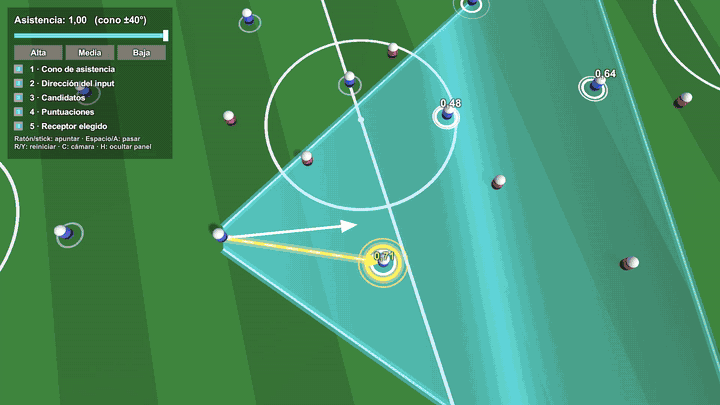

# Pase asistido estilo FIFA

> Cómo un cono de asistencia decide a quién va tu pase, recreado en Unity con gizmos.

## Qué muestra este proyecto
En los juegos de fútbol tipo FIFA, cuando pasas, el juego no envía el balón exactamente a donde
apuntas: desde el jugador sale un **cono** en la dirección del stick, se buscan los compañeros que
caen dentro, se les pone una **nota** y el pase va al mejor. Por eso el pase llega aunque apuntes mal.
Al bajar la asistencia el cono se cierra, y en **pase manual** solo queda una franja estrecha:
el balón va justo a donde apuntas y, si no hay nadie, se pierde.

No es el código de EA: es una recreación de la idea, con números propios.

**La nota de cada candidato** depende de una sola cosa: lo alineado que está con tu dirección
(1 = justo en la línea, 0 = en el borde del cono). Si dos empatan, gana el más cercano.

## Vídeo
- Vídeo completo: [Por qué tus pases en FIFA llegan aunque apuntes mal](https://youtu.be/DX2zvSkoDxY)
- Reels: _próximamente_

## Cómo probarlo
1. Clona el repositorio.
2. Ábrelo con **Unity 6000.6.4f1** (Unity 6, plantilla URP).
3. Abre una escena de `Assets/_Project/Scenes` y pulsa Play:
   - `Demo_AssistedPass`: la demo, con panel para cambiar la asistencia en directo.
   - `Demo_Comparison`: pantalla partida, mismo pase con asistencia alta y en manual.

| Control | Qué hace |
|---|---|
| Ratón / stick izquierdo | Apuntar |
| Espacio / A | Pasar |
| R / Y | Reiniciar la jugada |
| 1 a 5 | Capas de visualización: cono · dirección · candidatos · notas · receptor elegido |
| C | Cambiar de plano de cámara (TV → Táctica → Detrás) |
| H | Ocultar o mostrar el panel |

## Estructura
El código sigue una arquitectura por capas, cada una con su asmdef y dependencias solo hacia dentro:

- `Assets/_Project/Scripts/Domain` — la lógica pura, sin Unity: el cono y la puntuación
  (`ReceiverSelector`, `AssistConfig`). Es la parte que se explica en el vídeo.
- `Assets/_Project/Scripts/Application` — el estado de la jugada (`Play`) y los casos de uso
  (evaluar, pasar, reiniciar, cambiar la asistencia).
- `Assets/_Project/Scripts/Infrastructure` — lo que conecta con Unity: input, jugadores, balón, escenas.
- `Assets/_Project/Scripts/Presentation` — la visualización (gizmos por capas), el panel y la cámara.
- `Assets/_Project/Scripts/Tests` — tests del dominio y de la aplicación (Window → General → Test Runner).
- `Assets/_Project/ScriptableObjects` — perfiles de asistencia `Assist_High`, `Assist_Medium`, `Assist_Low` (manual).
- `Docs` — imágenes y GIFs del README.

## Créditos
Proyecto de ModoDebugOn, desarrollado con la ayuda de [Claude](https://claude.com/claude-code) (Anthropic).

## Licencia
MIT — consulta [LICENSE](LICENSE).
